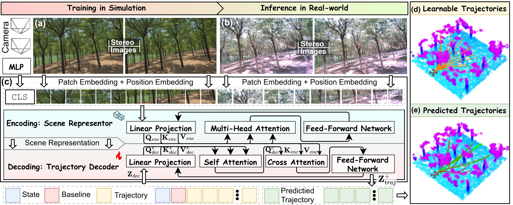
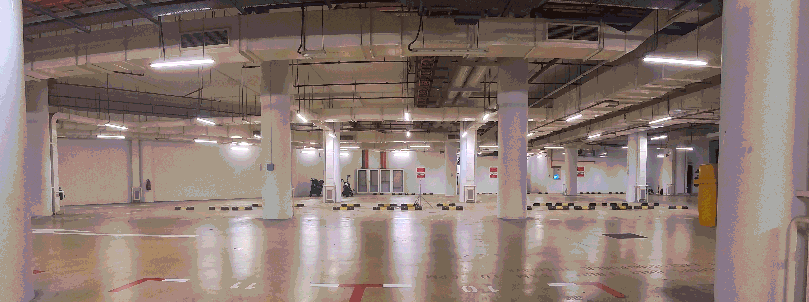
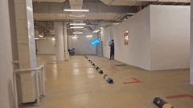
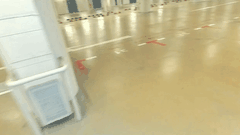
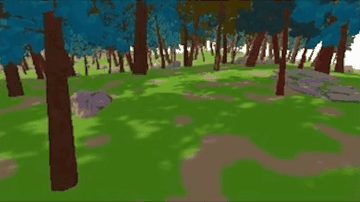
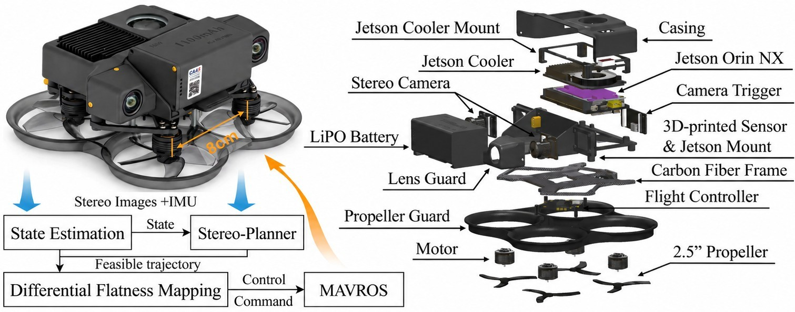

# Stereo-Planner: Learning Stereo-to-Trajectory Planning for Zero-Shot Sim-to-Real Quadrotor Navigation

Stereo-Planner is an end-to-end vision-to-action framework that directly generates agile, collision-free trajectories from onboard stereo RGB observations and enables zero-shot sim-to-real transfer without explicit depth reconstruction or dedicated depth sensors.



Training exclusively on simulation data enables agile flight in real-world environments.

<div align="center">
  <br />
  <em>Zero-Shot Flight in the Real World at Over 7 m/s</em>
</div>

<p align="center">
  
  <br />
  <em>Third-Person View (left) · First-Person View (right)</em>
</p>

Our simulator, built on the Unity game engine, enables plug-and-play scene construction using assets from the [Unity Asset Store](https://assetstore.unity.com/) and will be released as open source.

<p align="center">
  
  <br />
  <em>Forest Flight at 10 m/s (left) · Industrial Flight at 10 m/s (right)</em>
</p>

Our drone design and SOLIDWORKS CAD files will also be released as open source.

<div align="center">
  
</div>

## Acknowledgments
This project builds on [Depth Anything V3](https://github.com/ByteDance-Seed/depth-anything-3). We thank the authors for their excellent work!

## Additional Information
The [preprint](https://arxiv.org/abs/2610.15560) version is available. If you find this work useful, please consider giving this repository a star ⭐. 

```bibtex
@article{shen2026stereoplanner,
  title   = {Stereo-Planner: Learning Stereo-to-Trajectory Planning for Zero-Shot Sim-to-Real Quadrotor Navigation},
  author  = {Shen, Hongming and Lu, Junjie and Chen, Xun and Wang, Wei and Xu, Xinhang and Tian, Bailing and Xie, Lihua},
  journal = {arXiv preprint arXiv:2610.15560},
  year    = {2026},
  doi     = {10.48550/arXiv.2610.15560},
  url     = {https://arxiv.org/abs/2610.15560}
}
```
